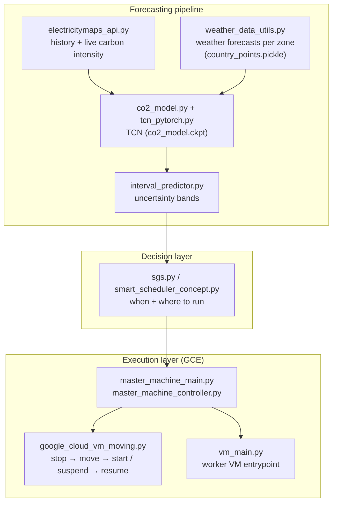

# ⚡🌱 Eco4Cast — Carbon‑Aware Forecasting & Scheduling for Google Cloud

<p align="center">
  
</p>

<p align="center">
  
  
  
  
</p>

> **Eco4Cast** is a research prototype for **carbon‑aware computing**: it *forecasts* the carbon intensity of electricity grids, and uses those forecasts to intelligently **schedule, pause, and move** batch workloads across Google Compute Engine VMs — shifting computation in **time** (run when the grid is clean) and in **space** (run where the grid is clean).

---

## Table of Contents

1. [Why Eco4Cast?](#why-eco4cast)
2. [Key Features](#key-features)
3. [How It Works](#how-it-works)
4. [Repository Layout](#repository-layout)
5. [Getting Started](#getting-started)
6. [Quick Start — Local](#quick-start--local)
7. [Quick Start — Google Cloud](#quick-start--google-cloud)
8. [Usage Examples](#usage-examples)
9. [The Carbon Forecasting Model](#the-carbon-forecasting-model)
10. [Vendored Google Cloud Snippets](#vendored-google-cloud-snippets)
11. [Testing](#testing)
12. [Development](#development)
13. [Roadmap](#roadmap)
14. [FAQ & Caveats](#faq--caveats)
15. [Contributing](#contributing)
16. [License](#license)
17. [Acknowledgements](#acknowledgements)

---

## Why Eco4Cast?

The carbon intensity of an electricity grid — grams of CO₂‑equivalent emitted per kWh consumed (`gCO₂eq/kWh`) — changes dramatically:

* **Over time** — solar power makes midday clean, wind lulls make evenings dirty.
* **Over space** — neighboring countries/zones can differ by a factor of 5–10× at the same moment (e.g., hydro‑powered vs. coal‑powered grids).

A large class of cloud workloads (ML training, simulations, rendering, batch analytics) is **flexible**: it doesn't care *exactly when* or *exactly where* it runs. Eco4Cast exploits that flexibility:

| Strategy | Mechanism | Eco4Cast component |
|---|---|---|
| **Temporal shifting** | Wait for / prefer low‑carbon hours before launching work | `sgs.py`, `smart_scheduler_concept.py` |
| **Spatial shifting** | Stop a VM and resume it in a cleaner zone | `google_cloud_vm_moving.py` |
| **Forecast‑aware planning** | Predict the next ~days of grid carbon intensity | `co2_model.py`, `tcn_pytorch.py` |
| **Risk‑aware decisions** | Quantify forecast uncertainty before committing | `interval_predictor.py` |

---

## Key Features

- 🔮 **Deep‑learning carbon forecaster** — a Temporal Convolutional Network (TCN) implemented in PyTorch, shipped pre‑trained (`co2_model.ckpt`).
- 🌦️ **Weather‑driven features** — weather forecasts are a leading indicator of wind/solar generation; `weather_data_utils.py` fetches and aligns them per zone (zone centroids are provided via `country_points.pickle`).
- 🗺️ **Electricity Maps integration** — historical, live, and forecast grid carbon intensity for hundreds of zones via the [Electricity Maps API](https://www.electricitymaps.com/).
- 📊 **Uncertainty quantification** — prediction intervals around point forecasts so the scheduler can trade off expected carbon savings vs. risk.
- 🧠 **Smart scheduler** — a master/worker controller that decides *when* and *where* to run jobs and orchestrates the necessary GCE operations.
- 🚚 **VM moving** — automated cross‑zone workload migration (stop → move → start / suspend → resume) built on Compute Engine.
- 💸 **Spot‑friendly** — designed with preemptible/spot VMs in mind, including preemption handling and retries.
- 📓 **Two guided notebooks** — a fully local quick start (no cloud account needed) and a full cloud quick start.

---

## How It Works



### 1. Forecast
Historical carbon intensity (Electricity Maps) and forecast weather data are combined and fed to the TCN, which outputs an hourly carbon‑intensity forecast per zone. `interval_predictor.py` wraps the point forecast with uncertainty bounds.

### 2. Decide
The scheduler (`sgs.py`) scores candidate **(zone, time‑window)** pairs by expected carbon footprint, weighted by the forecast uncertainty and the job's deadline/elasticity. The result is an execution plan: *run now here*, *delay N hours*, or *migrate to zone X*.

### 3. Execute
`master_machine_controller.py` (entry point `master_machine_main.py`) drives the Google Compute Engine API to realize the plan — creating/starting worker VMs, suspending or stopping them, moving them to cleaner zones (`google_cloud_vm_moving.py`), and resuming work. Worker VMs run `vm_main.py`, which pulls and executes the workload and reports status back to the master.

---

## Repository Layout

> Paths are grouped by role; see the individual module docstrings for details.

```
.
├── LICENSE
├── README.md
├── pyproject.toml                      # project metadata / packaging
├── requirements.txt                    # runtime dependencies
├── requirements-test.txt               # test dependencies
├── noxfile_config.py                   # configuration for shared nox sessions (lint/tests)
├── eco4cast_color.jpg                  # project logo
│
├── quick_start_guide.ipynb             # 🚀 end-to-end quick start on Google Cloud
├── local_quick_start_guide.ipynb       # 🏠 quick start without a cloud account
│
├── # ── Core forecasting & scheduling package ──────────────────────────
├── __init__.py
├── co2_model.py                        # PyTorch(Lightning) carbon-intensity model
├── co2_model.ckpt                      # trained model checkpoint
├── tcn_pytorch.py                      # Temporal Convolutional Network implementation
├── interval_predictor.py               # prediction intervals for forecasts
├── electricitymaps_api.py              # Electricity Maps API client
├── weather_data_utils.py               # weather forecast retrieval & feature engineering
├── country_points.pickle               # zone/country centroid coordinates for weather lookups
├── utils.py                            # shared helpers (time, caching, serialization)
├── sgs.py                              # smart scheduling strategy logic
├── smart_scheduler_concept.py          # prototype / design sketch of the scheduler
├── master_machine_controller.py        # orchestration logic (master side)
├── master_machine_main.py              # entry point for the master machine
├── google_cloud_vm_moving.py           # cross-zone VM migration helper
├── vm_main.py                          # entry point running on worker VMs
│
├── # ── Vendored Google Cloud Compute snippets ─────────────────────────
├── instances/                          # create/delete/start/stop/suspend/resume,
│                                       #   spot & preemptible VMs, bulk insert,
│                                       #   templates, encrypted start, serial port…
├── machine_images/  machine_types/     # reusable VM definitions & types
├── disks/  snapshots/  images/         # disk lifecycle, KMS-encrypted disks,
│                                       #   snapshots, custom images & families
├── firewalls/  routes/                 # network plumbing
├── operations/                         # long-running operation helpers
│   └── (list / wait / handle extended operations)
├── usage_reports.py, pagination.py …   # misc. API utilities
└── (each folder ships its own README.md / __init__.py)

├── # ── Tests ──────────────────────────────────────────────────────────
├── test_sgs.py                         # tests for the scheduling strategy
├── experimental_recipe.pytest          # experimental pytest "recipe" fixtures
├── ingredient1.pytest                  #   used to exercise test collection
└── ingredient2.pytest
```

---

## Getting Started

### Prerequisites

| Requirement | Notes |
|---|---|
| **Python ≥ 3.8** | PyTorch + Lightning based |
| **Google Cloud project** | Compute Engine API enabled |
| **Service account** | With Compute Admin (e.g., `roles/compute.instanceAdmin.v1`) or equivalent minimal scopes |
| **Electricity Maps API token** | Free tier is sufficient for experimentation — [sign up here](https://www.electricitymaps.com/) |
| *(optional)* `gcloud` CLI | Convenient for creating credentials and quotas checks |

### Installation

```bash
git clone https://github.com/<your-org>/eco4cast-y3gucj4n.git
cd eco4cast-y3gucj4n

# Create an isolated environment
python -m venv .venv && source .venv/bin/activate

pip install -r requirements.txt

# For development / testing
pip install -r requirements-test.txt
```

Core runtime dependencies include **PyTorch**, **PyTorch Lightning** (for the TCN model and the `co2_model.ckpt` checkpoint), **google-cloud-compute** (for VM orchestration), and **requests** (for the Electricity Maps and weather APIs). See `requirements.txt` for the exact, pinned list.

### Configuration

Eco4Cast reads its configuration from environment variables (and/or values set inside the notebooks):

| Variable | Purpose |
|---|---|
| `GOOGLE_APPLICATION_CREDENTIALS` | Path to your service-account JSON key |
| `GOOGLE_CLOUD_PROJECT` (or `GCP_PROJECT`) | Default GCP project for VM operations |
| `ELECTRICITYMAPS_API_TOKEN` | Your Electricity Maps API token |
| `ECO4CAST_DEFAULT_ZONE` | GCE zone used when no override is given |

```bash
export GOOGLE_APPLICATION_CREDENTIALS="$HOME/.config/gcloud/eco4cast-sa.json"
export GOOGLE_CLOUD_PROJECT="my-carbon-project"
export ELECTRICITYMAPS_API_TOKEN="********"
```

---

## Quick Start — Local

The local notebook requires **no GCP project**: it walks through fetching real grid carbon intensity, running the pre‑trained TCN forecast, and visualizing prediction intervals.

```bash
jupyter lab local_quick_start_guide.ipynb
```

What you'll do:

1. Query **live carbon intensity** for a few zones via the Electricity Maps API.
2. Pull **weather forecasts** for those zones and build model features.
3. Load `co2_model.ckpt` and generate a multi‑horizon carbon forecast.
4. Plot the forecast with its **uncertainty bands** (`interval_predictor.py`).
5. Rank hypothetical *(zone, hour)* execution slots by expected footprint.

---

## Quick Start — Google Cloud

The full pipeline (scheduling + real VM orchestration) is demonstrated in:

```bash
jupyter lab quick_start_guide.ipynb
```

The cloud walkthrough covers:

1. Authenticating to your GCP project.
2. Launching the **master** (`master_machine_main.py`) which plans the schedule.
3. Spawning **worker VMs** that execute `vm_main.py`.
4. Observing the controller **stop/migrate/resume** VMs as the forecast changes.
5. Comparing the carbon footprint of the scheduled run vs. a naive "run now, run anywhere" baseline.

---

## Usage Examples

> The notebooks are the canonical, runnable references; the snippets below illustrate the typical flow.

**Fetch carbon intensity data**

```python
from electricitymaps_api import ElectricityMapsClient

client = ElectricityMapsClient()  # token picked up from the environment
history = client.get_history(zone="DE")       # past carbon intensity
live    = client.get_latest(zone="DE")        # current gCO2eq/kWh
```

**Forecast with the pre‑trained TCN**

```python
from co2_model import CO2Model                 # Lightning module
from weather_data_utils import build_features  # weather → model inputs

model = CO2Model.load_from_checkpoint("co2_model.ckpt")
features = build_features(zone="DE")
forecast = model.predict(features)             # hourly gCO2eq/kWh
```

**Run the master controller**

```bash
python master_machine_main.py --help   # see available options
python master_machine_main.py          # plan + orchestrate the workload
```

**Move a VM to a greener zone**

```python
from google_cloud_vm_moving import move_vm

# stop → (re)create in target zone → start, preserving disks/state
move_vm(project="my-carbon-project",
        instance="worker-01",
        source_zone="europe-west3-a",
        target_zone="norway-east-a")
```

---

## The Carbon Forecasting Model

| | |
|---|---|
| **Architecture** | Temporal Convolutional Network (`tcn_pytorch.py`) — causal, dilated convolutions well suited to multi‑horizon time‑series forecasting |
| **Training framework** | PyTorch Lightning (checkpoint: `co2_model.ckpt`) |
| **Inputs** | Historical grid carbon intensity (Electricity Maps) + engineered weather features per zone (see `weather_data_utils.py`; zone coordinates from `country_points.pickle`) |
| **Outputs** | Hourly carbon intensity forecast (`gCO₂eq/kWh`), optionally as quantile intervals (`interval_predictor.py`) |
| **Intended use** | Ranking candidate execution windows/zones for flexible workloads |

> ⚠️ **Disclaimer** — forecasts are estimates for *scheduling guidance*, not audited emissions data. Always validate against the grid operator's published figures when reporting carbon savings.

---

## Vendored Google Cloud Snippets

This repository vendors the official **Google Cloud Compute Engine Python samples** (adapted from Google's `python-docs-samples`). They serve two purposes:

1. **Reference implementations** for every GCE operation the controller needs — VM create/delete, start/stop, **suspend/resume**, spot & preemptible VMs, bulk insert, machine images & templates, encrypted startup (`start_encrypted`), serial‑port output, firewall & route management, disks/snapshots (including KMS‑encrypted clones), custom images and image families, pagination, usage reports, and long‑running‑operation handling.
2. **A test bed** — the samples ship with their own test suites (`test_create_vm.py`, `test_spot_vms.py`, `test_instance_suspend_resume.py`, `test_firewall.py`, …), which help validate the GCE behaviors Eco4Cast depends on, such as suspend/resume semantics used during zone migration and spot‑VM preemption handling (`preemption_history.py`).

You generally **do not need to touch these directly** — `master_machine_controller.py` and `google_cloud_vm_moving.py` wrap the relevant operations — but they are handy if you want to extend Eco4Cast to new VM lifecycle patterns.

---

## Testing

```bash
pip install -r requirements-test.txt
pytest
```

* `test_sgs.py` covers the scheduling strategy logic.
* The `*.pytest` files (`experimental_recipe.pytest`, `ingredient1.pytest`, `ingredient2.pytest`) are experimental pytest recipe fixtures used to exercise custom test collection.
* The vendored GCE snippet tests validate the cloud operations against a live project (skipped automatically when no credentials are configured).

---

## Development

* **Packaging / metadata** lives in `pyproject.toml`.
* **Linting & test sessions** are wired through `noxfile_config.py` (compatible with the shared `nox` setup used by Google Cloud Python projects) — e.g. `nox -s lint`, `nox -s tests`.
* The scheduler design notes live in `smart_scheduler_concept.py`; `sgs.py` is the current implementation. Reading the concept file first is the fastest way to understand the decision logic.

---

## Roadmap

- [ ] Probabilistic scheduling that optimizes expected carbon *and* deadline risk jointly
- [ ] Carbon‑budget API ("stay under X gCO₂ for this batch")
- [ ] Native support for MIGs / managed instance groups
- [ ] Additional grid‑data providers beyond Electricity Maps
- [ ] Terraform module for one‑command deployment of the master + workers
- [ ] Dashboard for live forecast vs. actual intensity
- [ ] Multi‑cloud movers (AWS/Azure) alongside GCE

---

## FAQ & Caveats

<details>
<summary><b>Does stopping and moving VMs actually reduce emissions?</b></summary>

Yes — provided the workload is deadline‑flexible and data‑light. Emissions scale with *when* and *where* electricity is consumed; shifting load to cleaner hours/zones displaces marginal fossil generation. The `interval_predictor.py` uncertainty bands exist precisely so the scheduler doesn't chase noise in the forecast.
</details>

<details>
<summary><b>What about egress costs and state when moving VMs?</b></summary>

Migration is stop‑and‑resume based (GCE live migration does not cross zones). Keep job state on persistent disks or in object storage, and checkpoint regularly. Jobs that shuttle gigabytes between zones may negate the carbon savings — design workers to be self‑contained.
</details>

<details>
<summary><b>Can I use spot/preemptible VMs?</b></summary>

Yes, and it's recommended: spot VMs are both cheaper and a natural fit for interruptible, carbon‑aware scheduling. The controller includes preemption handling and retry logic (see the preemption snippets).
</details>

<details>
<summary><b>Which zones are supported?</b></summary>

All zones covered by the Electricity Maps API. `country_points.pickle` provides the geographic anchors used for weather lookups; coverage and resolution vary by zone.
</details>

---

## Contributing

Contributions are welcome!

1. Fork & create a feature branch.
2. Run `nox -s lint` and `pytest` locally.
3. Open a pull request describing the motivation and any forecast‑quality impact (include before/after plots for model changes).

---

## License

This project is distributed under the terms of the [LICENSE](LICENSE) file included in the repository.

---

## Acknowledgements

- 🌍 [Electricity Maps](https://www.electricitymaps.com/) — grid carbon‑intensity data & API
- ☁️ [Google Cloud python-docs-samples](https://github.com/GoogleCloudPlatform/python-docs-samples) — the vendored Compute Engine snippets
- 🔥 [PyTorch](https://pytorch.org/) & [PyTorch Lightning](https://lightning.ai/) — model implementation and training
- 📈 Bai et al., *An Empirical Evaluation of Generic Convolutional and Recurrent Networks for Sequence Modeling* (TCN)

<p align="center">
  <i>Run smarter, not harder. 🌱</i>
</p>
